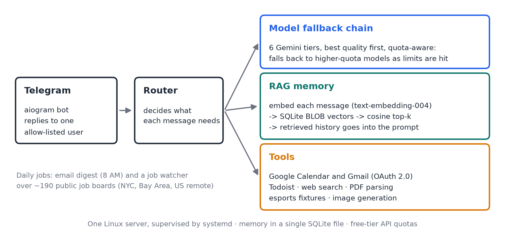

# Hermes

A personal Telegram AI assistant with long-term memory, built on retrieval-augmented generation over a local SQLite vector store.

Runs continuously on a Linux server under `systemd` as a personal assistant (access is restricted to a single allow-listed Telegram user).

---

## Why it exists

Most chatbots forget everything between sessions. Hermes remembers: every message is embedded and stored, and relevant history is retrieved by vector similarity and fed back into the model's context on each turn.

Everything runs against free-tier API quotas, which drove most of the interesting engineering — model fallback chains, quota-aware routing, and a local vector store instead of a hosted vector database.

## Architecture



The same structure as text:

```
Telegram (aiogram)
        │
        ▼
   Router ──────► Model fallback chain (6 tiers, quota-aware)
        │
        ├──► RAG memory   embed → SQLite (BLOB vectors) → cosine top-k → context
        │
        └──► Tools        Google Calendar · Gmail · Todoist · web search
                          PDF parsing · esports fixtures · image generation
```

### Retrieval-augmented memory

Messages are embedded with `text-embedding-004` (`task_type=RETRIEVAL_DOCUMENT`) and stored as BLOBs alongside their text in SQLite. At query time the incoming message is embedded, scored against every stored vector with a hand-written cosine similarity, and the top matches are injected into the prompt.

No external vector database — SQLite plus NumPy is sufficient at this scale and keeps the deployment to a single file on disk.

### Model fallback

Free-tier models have low daily request limits, so a single model is not a reliable dependency. Requests walk an ordered chain, best quality first, degrading toward higher-quota models as limits are hit:

```python
TEXT_MODEL_FALLBACKS = [
    "gemini-3.5-flash",       # best quality      —  20 RPD
    "gemini-3-flash",         # 2nd best          —  20 RPD
    "gemini-2.5-flash",       # 3rd best          —  20 RPD
    "gemini-3.1-flash-lite",  # high-volume       — 500 RPD
    "gemini-2.5-flash-lite",  # high-volume       —  20 RPD
    "gemini-2.0-flash",       # final safety net  — always-on
]
```

A separate chain handles image generation. The bot stays responsive even when every premium tier is exhausted.

### Integrations

| Service | Capability |
|---|---|
| Google Calendar | read, create, and modify events (OAuth 2.0) |
| Gmail | read and send (OAuth 2.0) |
| Todoist | task management |
| Job feeds | `/jobs` and a daily list of new roles from company boards on Greenhouse, Lever and Ashby (see below) |
| Email digest | `/digest` and a daily 8 AM summary of event and career emails from your own Gmail (see below) |
| DuckDuckGo | live web search |
| PandaScore | esports fixtures and results |
| PDF / HTML | document parsing and summarization |

Multiple Google accounts are supported — each is authorized separately and stored as its own token file.

### Job watcher

`jobs.py` reads the public job-board feeds that Greenhouse, Lever and Ashby publish for each company (no login, no account, no scraping behind a login). The companies, title keywords, exclusions and locations live in `jobs_config.json`, so the list is edited as data. Matching is plain rules with whole-word checks, so no model call is involved and nothing written in a posting can steer the bot. Companies are grouped into tiers in the config (my own judgment of pay and selectivity, not measured data), and higher tiers score higher. The default pay target is $170,000 in annual total compensation (`min_total_comp`): stated base salary, annual bonus and explicitly annualized equity. One-time signing bonuses are shown separately and do not count toward recurring annual pay. Both targets apply: a role is dropped when its stated base range tops out below `min_pay` ($135,000), or when an explicit annual total range tops out below `min_total_comp`. Roles with unknown pay and ranges crossing the target remain, labelled "total pay: unknown" or "possible". Unpriced equity, benefits and multi-year grants are never assigned invented values, and target bonuses and stock values are not guaranteed. A starting base of `max_start_pay` ($300,000) or more usually means an experienced hire, so those roles are hidden and counted, unless the title says new grad or early career or the employer is on `high_pay_new_grad_firms` (trading firms that pay new grads at that level). Only full-time roles are kept: internships, co-ops, contracts and part-time roles are dropped by title and by the feed's own employment type. The list is tuned for entry-level, post-graduate roles: senior, staff, lead, principal, manager, "experienced" and mid-level titles are dropped, and so are level-two and level-three titles ("Software Engineer II", "Engineer 2", "Level 3") unless the title itself says new grad, university, campus or early career (`max_level` 1); postings that ask for three or more years of experience are skipped (`max_years` 3); 1–2-year requirements stay visible with a warning. Literal graduation windows, start dates and explicit PhD requirements are shown for review without hiding roles; titles that say new grad, entry level, campus, masters or early career rank above plain ones (`junior_bonus`). No company can take more than three slots in one message. Roles are scored (role match, entry level, New York, posted in the last two weeks), the best unreported ones are sent, and what was shown is remembered so it is not repeated. Visa wording in a posting is shown only as a hint (`says no sponsorship`, `citizenship or clearance required`, `mentions sponsorship`, or `not stated`); it can be missing or out of date. The bot never applies to anything.

Besides those three, it reads Amazon's job search and the job lists of companies that use Workday (NVIDIA, Salesforce, Adobe, Capital One, Mastercard, PayPal, Cisco, Snap and others) for New York, San Francisco Bay Area and remote US roles. Those two are the sites' own data feeds, not published APIs: they can change without notice, and they are read gently (a few requests per company per day, an honest user-agent, and only paths the sites' robots.txt allows). Google and Apple are read from their public search pages (first page only; Google's robots.txt disallows paging), with a separate HTML fetch: Google's posting pages are also read so pay, visa wording, years of experience and the New York location are checked like everywhere else, while Apple listings are labeled "posting details not read". Meta, Microsoft and Netflix load their jobs with JavaScript (or refuse plain requests), so a separate script, `browser_reader.py`, opens their public search pages in a real Chrome on a laptop (never the small server), once per keyword and once a day, and copies the visible titles and locations to `browser_jobs.json`, which `deploy/mac/run_browser_reader.sh` then copies to the server. It does not log in, hide that it is automated, solve captchas or retry past a refusal; if a site errors or shows a block page, that source is skipped and the reason is recorded. The three sites' `robots.txt` files allow the paths it uses, but their terms may not allow automated reading, so it is for personal use only. Listings from it are labeled "posting details not read". The monthly Hacker News "Ask HN: Who is hiring?" thread is read through its public search API, so small startups appear too (pay and visa notes come from what the poster wrote). Companies are read four at a time. Other job-alert emails can be read by the digest once exact sender addresses are listed in `HERMES_JOB_ALERT_SENDERS` (comma separated; off by default, and only the real address in the From line is trusted). A full scan of 117 sources takes about half a minute on the small server. What it cannot see: companies on other systems, roles that need a login to view, and any location written in a way the rules do not recognize.

**Where:** New York first, then the San Francisco Bay Area and remote US. Every reader asks for New York and the Bay Area (Workday filters, Amazon, Google, Apple, TikTok's New York and San Jose codes) or filters the feed itself; remote roles count only when they are in the US. New York roles score higher, so they come first; a role listed in several cities passes if any one of them is allowed, and a Bay Area city only counts where no excluded country is named (so "Costa Rica, San Jose" is out). When Workday shows only "3 Locations", the role is labelled "San Francisco Bay Area or remote (one of 3 Locations)" and marked unverified.

Retool and Groq are read through Gem's documented public Job Board API (`api.gem.com/job_board/v0/<slug>/job_posts/`, Greenhouse-shaped, with descriptions); Radix through its university Greenhouse board (`radixuniversity`).

**Ratings and tiers:** every company carries four 1-5 scores, `pay`, `prestige`, `wlb` (work-life balance) and `exits` (exit opportunities after 2-3 years), plus `sponsor` (whether it usually sponsors H-1B). They are **estimates by a model (Claude Fable 5.1, Oct 18 2026) from general knowledge, not measured data**, and 33 are marked `unsure`; edit them in `jobs_config.json` if you know better. The tier, which raises a company in the daily list, is the sum of the four scores (17+ tier 1, 15-16 tier 2, 12-14 tier 3, else 4). Each role shows the scores next to the tier. The sponsor estimate is shown only when the posting itself says nothing about visas, and is labelled as an estimate; what the posting says always wins.

Three quant and finance firms are read from their own careers pages (each page allowed by its robots.txt): **Bloomberg** and **Two Sigma** (both run Avature; the search pages are read page by page with a one-second pause, about 30 requests for Bloomberg and 10 for Two Sigma per run; only the title, location and level are known, so the bot says the posting details were not read) and **D. E. Shaw** (its careers page embeds the public job list as JSON; one request, with the description, so pay is read). Oracle Recruiting sites (**American Express**, **Oracle**), **TikTok** (New York only; it needs the `website-path` header its own site sends) and **Atlassian** are read through the public job APIs their careers pages use (keyword searches, up to three pages of 100; New York is filtered by the bot, since the API ignores location). **Not read, on purpose:** Citadel and Citadel Securities, Tesla, Uber (pages answer automated requests with a bot-protection block); SIG, JPMorgan's Oracle site, Millennium, Morgan Stanley, Qualcomm, Hugging Face and Intuit (their robots.txt disallows the job API, even where it answers); LinkedIn (its terms forbid it). Added once the Bay Area and remote US counted: Intel, Zillow, CrowdStrike, Vanguard (Workday) and AMD, GitHub, DocuSign (their Jibe careers sites' public `/api/jobs`). Yahoo labels its roles only as "United States", so its Workday filter cannot be matched. Also read: **Rippling** (its public ATS board API), **Dell** (Oracle Recruiting behind its own domain) and **Deloitte** (Avature; roles listed only as "Multiple Locations" are opened, at most 20 per scan, to read their cities). Splunk's roles are on Cisco's board, which is read. **Uber** is read through the search endpoint its own careers site (jobs.uber.com, robots.txt `Allow: /`) calls, via `public_jobs.py`: an honest user-agent, a robots.txt check of the exact path that is stricter than Python's own parser (it also honours later `Disallow` groups that the standard parser misses), one request per URL, a pause between pages, no retries, and a full stop for that site on any 403 or 429. The same transport reads 29 more employers checked by hand for New York, Bay Area or remote roles (Valon, Amplitude, Exa, Cartesia, EliseAI, Modern Treasury, Reducto, Prime Intellect, Pure Storage, Justworks, Fastly, DV Trading and others): most through Ashby's public posting API, a few Greenhouse boards with descriptions in one request (`public_feed`), and Whatnot from its public Ashby board page (`ashby_html`, at most two postings opened per scan). A third pass added 126 more: boards for employers whose engineering roles are in New York, the Bay Area or US remote even when no junior role is open today (Hermes checks daily), boards found under other names, ServiceNow's public sitemap, SIG (its Jibe listing API), Morgan Stanley's graduate feed, Intuit's search pages, Hugging Face (Workable), Booz Allen and Blizzard (public sitemaps and job pages, capped), and Ashby boards such as Aurora, Superhuman, Kalshi, Polymarket, Sentry and Temporal through Ashby's public posting API. Employers whose checked postings refuse new visa sponsorship were left out. Navan, Millennium, Goldman Sachs and JPMorgan are not read: their own careers sites disallow automated access. A fourth pass added 35 more boards found through each company's own careers links (Workday, Lever, Recruitee and Teamtailor feeds included) and corrected a few board identities. An optional reader can turn job-alert emails the owner subscribes to (for example LinkedIn alerts for employers whose sites can't be read) into normal /jobs entries; it is off unless `HERMES_JOB_ALERT_RECORDS=1` and an exact-sender allowlist in `HERMES_JOB_ALERT_SENDERS` are set, reads Gmail read-only, never opens the links, and de-duplicates against the boards Hermes already reads. Not read: Goldman Sachs, Walmart and Balyasny (robots.txt disallows their job pages or API); no public feed found for IBM, HubSpot, McKinsey, Grammarly and Aurora; Google DeepMind's roles appear on Google's careers search; Blizzard and Yahoo have no New York, Bay Area or remote roles. Defense firms are read like any other (**RTX**, **Boeing**, **Northrop Grumman**, **Leidos**, **General Dynamics IT**), and each posting is screened: one that says U.S. citizenship, U.S. person status or a security clearance is required is hidden and counted (`hide_ineligible`, on by default), while a mere mention of clearance or export control is shown with a 🔎 note. Sentences that say the opposite ("no clearance required") do not count. Not read: Anduril (its 2.7 MB feed takes about 30 s to start answering, longer than the bot waits), NSA (USAJOBS only), Lockheed Martin (own site, no feed found), Booz Allen (its Workday site has no location filter the bot can match). The bot does not work around any of these; use those firms' own job-alert emails (see `HERMES_JOB_ALERT_SENDERS`) or check them by hand.

### Hackathons and company sessions

`/hackathons [n]` lists the best upcoming hackathons from Luma's public New York feed and any public Luma calendars named in `hackathons_config.json` (Luma's search needs a login, so only listed events are found). Two more lists feed it: the big public Luma AI community calendars (kept to New York events), and Cerebral Valley's New York hackathon list, which loads its events with JavaScript and is therefore read by `browser_reader.py` in a real Chrome on a laptop once a day (the page itself is allowed by its robots.txt; its `/api/` paths are not touched). Each candidate's public page is read for the description, price, whether it is full or needs approval, prize amounts and the real start and end times, then scored with plain rules (AI focus, known sponsors, prizes, free, in person, length, how soon, and clashes with your fixed schedule from the config). No model call is involved, and it never registers you for anything.

`/hackathons mine` lists the events you have signed up for (kept in the config's `registered` list, taken from your Luma confirmation emails) with their times, places and clashes with classes, other commitments and each other, and those events are hidden from the recommendations and counted as busy time for the next ones.

`/campus` lists company info sessions and recruiting events (Zoom or on campus). Campus Groups itself needs a login, so the bot does not open it. Instead it uses Campus Groups' own calendar feed (the "Subscribe to Calendars" links, set in the environment as `CAMPUS_ICS_ALL` and optionally `CAMPUS_ICS_MINE` for the events you registered for; the links may contain a private key and are never printed or logged), which needs no login or Google sign-in. Without those, it falls back to reading the career emails Campus Groups and Career Management already send you. The model must answer with JSON only, every field is validated in code (dates, times, no links or markup) and sessions are sorted, ranked by company tier and checked against your schedule, so nothing in an email can add a link or an invented session. It needs the Google sign-in.

### Applying: tracker, fit check, follow-ups

`/jobs` browses the stored pending queue instantly; `/jobs refresh` explicitly scans the boards. Each role has a stable job ID. `/fit <job-ID>` (or reply to the original jobs message with `/fit 3`) asks the model how well role 3 fits the resume summary on the server (a score from 1 to 5, why, the gaps, and which of ten resume versions to send); the posting is treated as untrusted text and the model has no tools. `/save <job-ID>` and `/applied <job-ID> [resume]` record it in a small tracker (`/applied Company | Role | resume` works for roles found elsewhere), `/pipeline` lists everything by status, `/mark <id> interview|offer|rejected|withdrawn` updates it, and a week after an application the bot reminds you to follow up, once. Postings older than 60 days are dropped and each result shows how long ago it was posted. Source status records show how many sources answered ("Sources: 196/201 succeeded") and, for each one that failed, when it last worked, so a broken or blocked source never looks like "no openings". The bot never applies to anything. The resume summary (`fit_profile.json`) has no contact details and is kept out of the repository. `/sources` shows current healthy, stale, partial, failed and never-checked counts. See [stored jobs and stable references](docs/job-queue.md) for browsing, delivery and migration details.

### Email digest

`digest.py` reads recent mail from a short list of senders (Campus Groups, Luma, Handshake, the school's own address) through the Gmail API and asks the model for a few lines grouped into events, career items and deadlines. It never logs in to a website or stores a password. The mail text is treated as untrusted: the model is told to use only what is written, to ignore instructions inside it, and it has no tools to call. Reported messages are remembered so nothing repeats, and a failed summary does not mark them as seen. It is tested against fake Gmail responses; it has not yet been run against a large real mailbox.

## Stack

Python · aiogram · google-generativeai · SQLite · httpx · BeautifulSoup · pypdf · Honcho

## Running it

```bash
pip install -r requirements.txt
cp .env.example .env        # fill in your keys
python auth_calendar.py     # once per Google account
python main.py
```

Deploy with the included `hermes.service`:

```bash
sudo cp hermes.service /etc/systemd/system/
sudo systemctl enable --now hermes
```

`Restart=always` keeps it up across crashes and reboots.

## Tests

```bash
pip install pytest
pytest -q
```

229 tests cover the logic that does not need the network (20 for the core bot, 19 for the digest with fake Gmail responses, the rest for the job watcher, the Amazon and Workday readers, the tracker and the fit check, all with fake feeds), including the daily timer across a clock change and checks that mail or posting text cannot change what the bot does: Markdown to Telegram HTML, the quota-aware model routing (cooldowns, unavailable models, the cheap tier for small talk), vector packing and cosine similarity, the SQLite memory with semantic recall, and the email and match-time formatters. The Telegram, Gemini and Google libraries are replaced with stand-ins in `tests/conftest.py`, so the tests run without credentials. The integrations themselves (Calendar, Gmail, Todoist, search) are not covered by tests.

## Configuration

All secrets come from the environment — nothing is hardcoded. See `.env.example`.

| Variable | Purpose |
|---|---|
| `BOT_TOKEN` | Telegram bot token |
| `GEMINI_API_KEY` | Google Generative AI |
| `ALLOWED_USER_ID` | Telegram user ID permitted to use the bot |
| `HONCHO_API_KEY` | user-memory service |
| `TODOIST_TOKEN` | Todoist API |
| `PANDASCORE_TOKEN` | esports data |
| `DIGEST_HOUR` | hour (New York time) of the daily digest, default 8 |
| `DIGEST_DAILY` | set to `off` to disable the daily message |
| `JOBS_DAILY` | set to `off` to disable the daily job list |
| `JOBS_FAST_LANE` | set to `off` to disable the hourly check of top-tier companies (tiers 1-2 on light API readers; sends only roles that appeared since the previous check, nothing 23:00-07:00 New York time; the first run only learns the current backlog) |
| `JOBS_FAST_LANE_MINUTES` | minutes between fast-lane checks (default 60, minimum 30) |
| `HERMES_JOB_ALERT_RECORDS` | `1` enables the independent job-alert email worker; default off |
| `HERMES_JOB_ALERT_SENDERS` | comma-separated exact, verified email sender addresses |
| `HERMES_JOB_ALERT_ACCOUNTS` | optional local account labels; empty uses working accounts |
| `HERMES_JOB_ALERT_INTERVAL_SECONDS` | mailbox poll interval, default 300 seconds |

Access is restricted to `ALLOWED_USER_ID`; every handler checks it before doing any work.

## Job-alert email setup

See [job-alert setup and recovery](docs/job-alerts.md) for official signup routes, real-template validation, the opt-in mailbox worker and `/jobalerts` commands. The worker reads subscribed mail independently of daily board scans and acknowledges listings after Telegram delivery. Unsupported emails are retained for parser support.

## License

MIT

---

Built by [Elmir Abdullaiev](https://github.com/elmir132)
